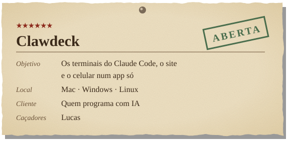
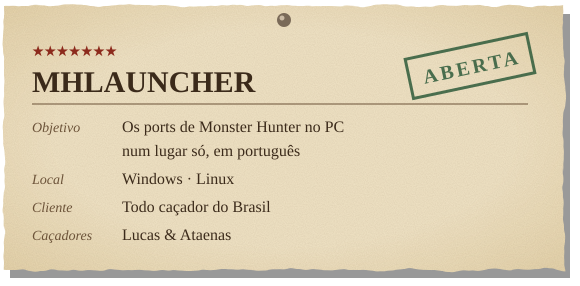
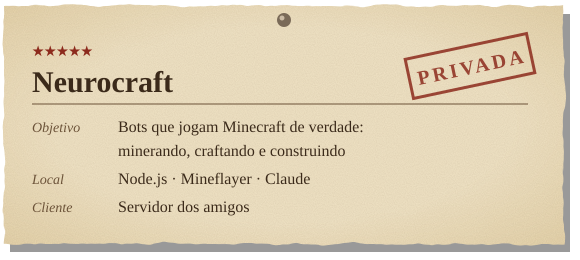
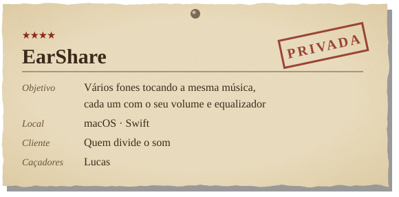

Oi! Eu sou o **Lucas**, mas na internet é **licas.mp3**. 🍖

Fiz o curso de **Inteligência Artificial no SENAI** e hoje passo boa parte do tempo construindo coisas com IA: apps, sites e ferramentas que eu mesmo uso no dia a dia. Gosto de pegar uma ideia e ir até o fim, do primeiro rascunho ao instalador pronto.

Fora do código, quase sempre estou caçando em **Monster Hunter**. Gosto tanto que traduzi o **4 Ultimate** e o **Generations Ultimate** pra português e fiz um launcher pra jogar os ports no PC. Também curto mexer com tradução de jogos, áudio de alta fidelidade, hardware e fazer live na Twitch.

<table>
<tr>
<td align="center"> <b>Nargacuga</b></td>
<td align="center"> <b>Green Nargacuga</b></td>
</tr>
<tr>
<td align="center"> <b>Nergigante</b></td>
<td align="center"> <b>Zinogre</b></td>
</tr>
</table>
GIFs via Tenor · Monster Hunter © Capcom

  

