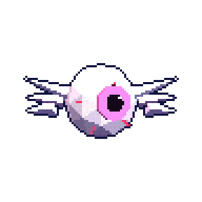
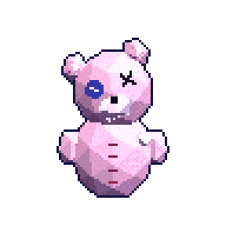
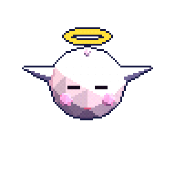
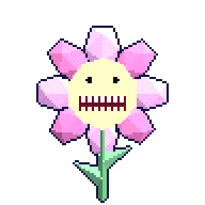
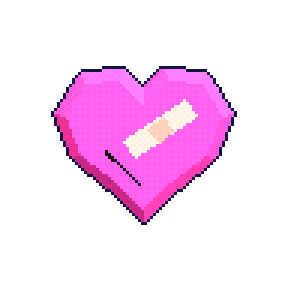
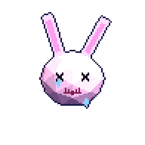
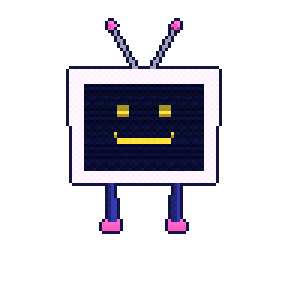
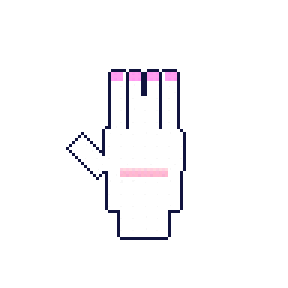

Oi! Eu sou o **Lucas**, mas na internet é **licas.mp3**.

Gosto muito de jogos e de criar apps e sites, quase sempre com IA do meu lado. Pego uma ideia e vou até o fim, do primeiro rascunho ao instalador pronto. Ultimamente também estou me aventurando em **design**.

Agora estou fazendo o **MHLAUNCHER** junto com a minha amiga [@Ataenas](https://github.com/Ataenas).

<table>
<tr>
<td align="center" width="25%"> <i>ele te observa</i></td>
<td align="center" width="25%"> <i>costurado com carinho</i></td>
<td align="center" width="25%"> <i>shh, não acorda ele</i></td>
<td align="center" width="25%"> <i>sorria :)</i></td>
</tr>
</table>

O Projeto Farol é da <a href="https://wisemadness.org.br">Wise Madness</a>, uma ONG aqui de Bauru.

Jogo de tudo um pouco, mas o que me pega mesmo são os **jogos de história**, os **jogos de grind** e, acima de tudo, o **terror**.

No terror, o meu lugar é o low-poly com cara de PS1, estranho e meio sonho. **Mama's Sleeping Angels** é o meu favorito, e logo atrás vêm Cry of Fear, Afraid of Monsters, Nun Massacre, Gloomwood e Stay Out of the House. No grind, é **Monster Hunter**: gostei tanto que traduzi o 4 Ultimate e o Generations Ultimate pra português.

Fora dos jogos, **estudo áudio por hobby** (fones, hi-fi e como o som funciona) e de vez em quando faço live na Twitch.

<table>
<tr>
<td align="center" width="25%"> <i>ainda bate</i></td>
<td align="center" width="25%"> <i>tá tudo bem</i></td>
<td align="center" width="25%"> <i>boa noite!</i></td>
<td align="center" width="25%"> <i>oi (˘ω˘)</i></td>
</tr>
</table>

  

