<!-- oi, curioso. se vc tá lendo o código do meu perfil, tem uma sala escondida. procura o pontinho. -->

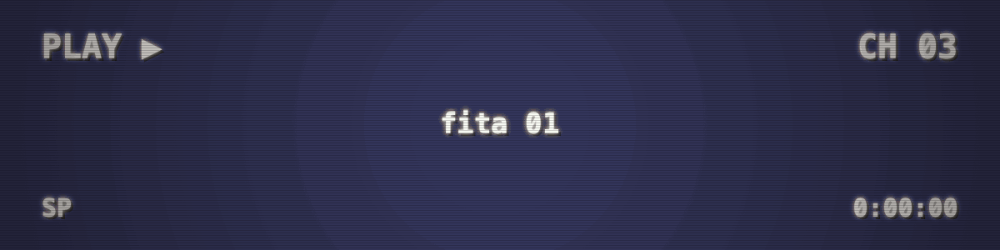

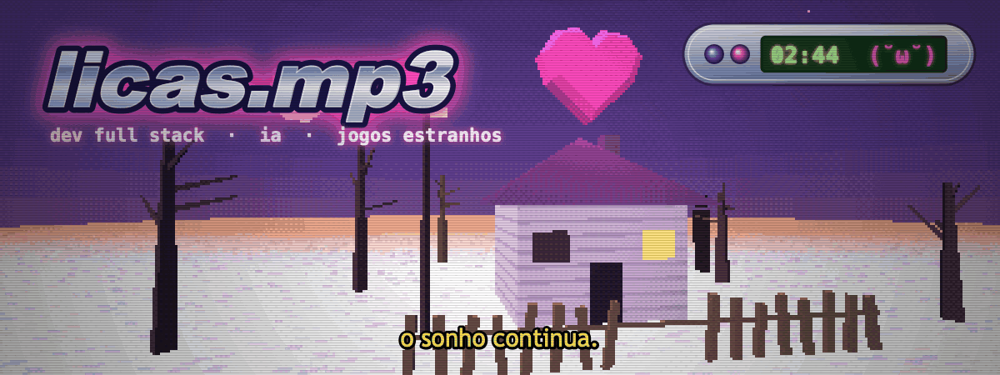

<a href="https://github.com/licasmp4/licasmp4/blob/main/salas/01-corredor.md">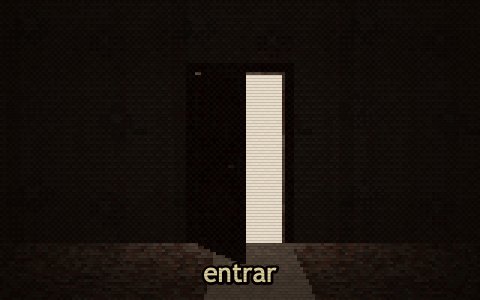</a>

tem uma porta aberta aqui. entra se tiver coragem (4 salas, dá pra se perder)


oi, sou o **lucas** (ou **licas.mp3** por aí)

gosto mt de jogo e de criar app e site, quase sempre com ia junto. quando pego uma ideia eu vou até o fim kkk. agora tô me aventurando em **design** tb, ainda aprendendo

no momento tô fazendo o **MHLAUNCHER** com a minha amiga [@Ataenas](https://github.com/Ataenas)

<table>
<tr>
<td align="center" width="25%">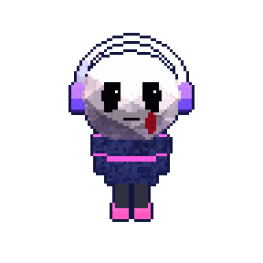 <b>person</b> · eu, às 3 da manhã</td>
<td align="center" width="25%">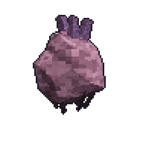 <b>monster</b> · coração andante</td>
<td align="center" width="25%"> <b>painting</b> · a estátua que olha</td>
<td align="center" width="25%">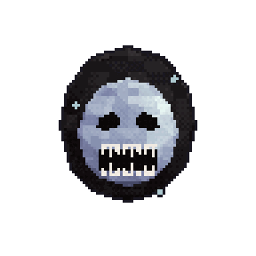 <b>monster</b> · o sorriso</td>
</tr>
</table>

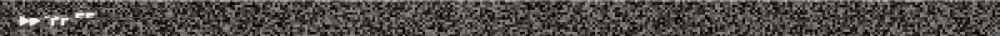


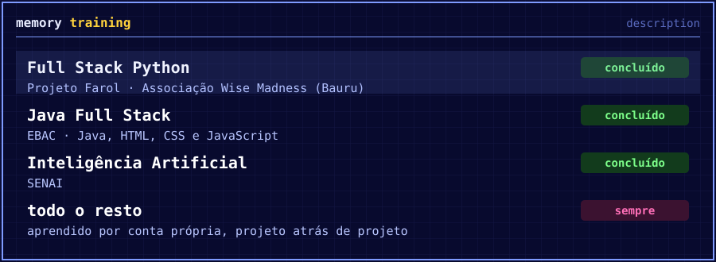

o projeto farol é da <a href="https://wisemadness.org.br">wise madness</a>, uma ong aqui de bauru


<a href="https://github.com/licasmp4/Clawdeck">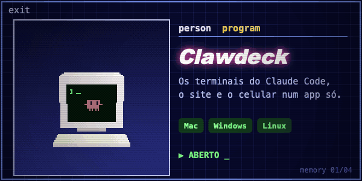</a>
<a href="https://github.com/licasmp4/MHLAUNCHER">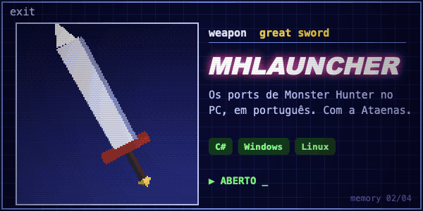</a>
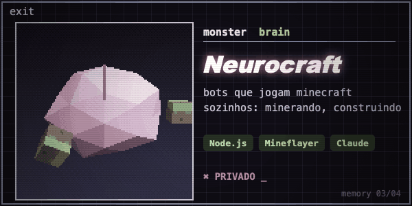
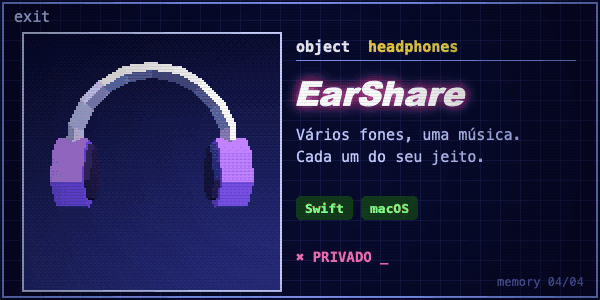


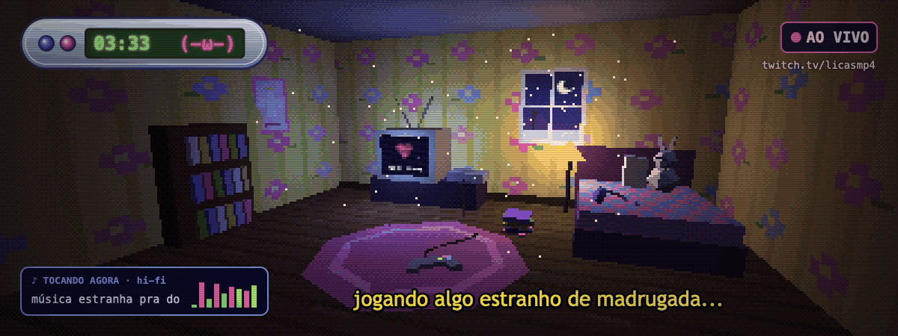

jogo de tudo, mas oq eu curto mesmo é jogo com **história** boa, jogo de **grind** e **terror**. terror principalmente

sou apaixonado por terror low-poly, aquela cara de ps1 meio bizarra me deixa confortável sla. **mama's sleeping angels** é o meu favorito disparado, depois vem **tower of tears**, cry of fear, afraid of monsters, nun massacre, gloomwood, stay out of the house...

de grind é **monster hunter**, joguei tanto que acabei traduzindo o 4u e o gu pra pt-br

fora isso estudo **áudio** por hobby (fone, hi-fi, essas coisas) e às vezes faço live na twitch

<table>
<tr>
<td align="center" width="25%">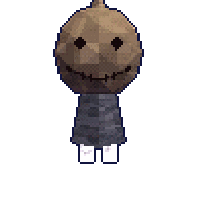 <b>monster</b> · sorriso costurado</td>
<td align="center" width="25%">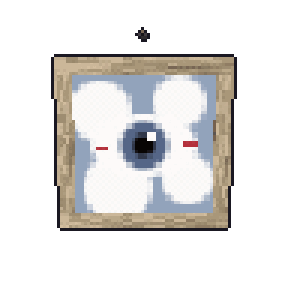 <b>painting</b> · o olho nas nuvens</td>
<td align="center" width="25%">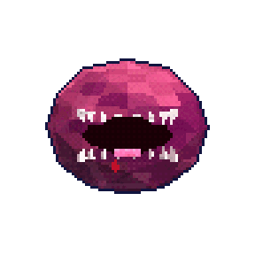 <b>curse</b> · fome</td>
<td align="center" width="25%">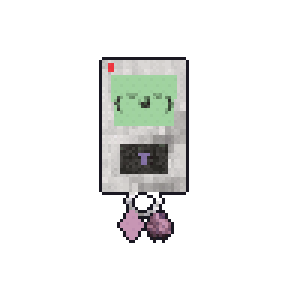 <b>item</b> · pager do sonho</td>
</tr>
</table>

<a href="https://github.com/licasmp4/licasmp4/blob/main/salas/03-memory.md">abrir o memory completo →</a>



<table>
<tr>
<td align="center"></td>
</tr>
</table>


se vc chegou até aqui, deixa um oi no [livro de visitas](https://github.com/licasmp4/licasmp4/issues/1). teu nome aparece escrito na parede aqui embaixo (atualiza sozinho em até 1h)

só o nome de usuário vai pra parede, pode ficar tranquilo

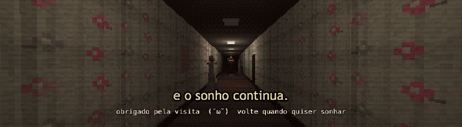

.

psiu. tem uma sala que não aparece no mapa → <a href="https://github.com/licasmp4/licasmp4/blob/main/salas/segredo.md">entrar</a>

