Oi! Eu sou o **Lucas**, mas na internet é **licas.mp3**.

Gosto de construir coisas com IA: apps, sites e ferramentas que eu mesmo uso no dia a dia. Pego uma ideia e vou até o fim, do primeiro rascunho ao instalador pronto.

Sou apaixonado por **jogos low-poly**. Aquela cara de PS1 e PS2 me dá um conforto difícil de explicar, ainda mais quando vem junto com uma estética bizarra e meio sonho, meio pesadelo. Também jogo muito **Monster Hunter**: traduzi o 4 Ultimate e o Generations Ultimate pra português, e estou fazendo o **MHLAUNCHER** junto com a minha amiga [@Ataenas](https://github.com/Ataenas).

Fora isso, curto áudio de alta fidelidade, hardware e fazer live na Twitch.

O Projeto Farol é da <a href="https://wisemadness.org.br">Wise Madness</a>, uma ONG aqui de Bauru.

<b>Mama's Sleeping Angels</b>: o que mais me encanta (˘ω˘)

  

<table>
<tr>
<td align="center" width="50%"> <b>Cry of Fear</b></td>
<td align="center" width="50%"> <b>Gloomwood</b></td>
</tr>
<tr>
<td align="center"> <b>Stay Out of the House</b></td>
<td align="center"> <b>Monster Hunter</b></td>
</tr>
</table>

e também <b>Afraid of Monsters</b> e <b>Nun Massacre</b>

  

