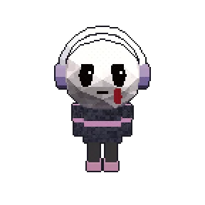
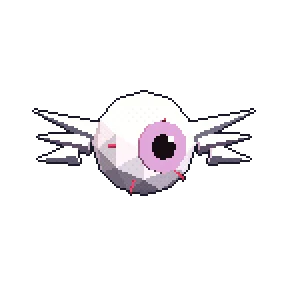
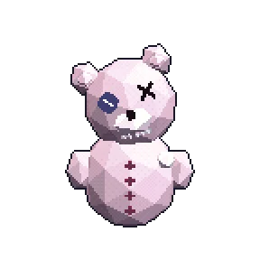
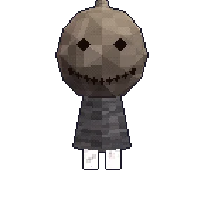
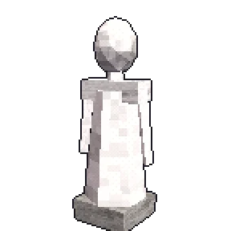
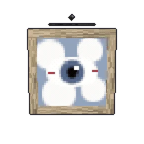
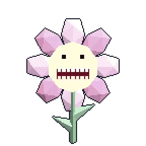
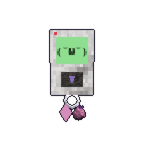
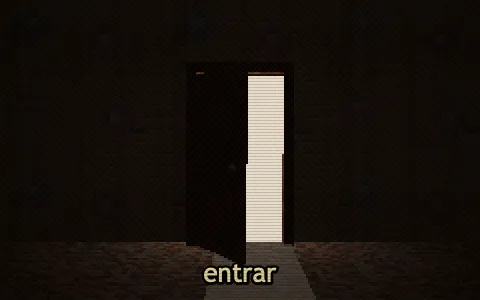

### memory

as coisas que moram aqui embaixo. não precisa ter medo de todas.

| | |
|:-:|:--|
|  | **person · eu, às 3 da manhã** acordado mais do que devia. o fone nunca sai do pescoço. tem uma estrelinha que segue ele. como lembrar: abrir o terminal depois da meia-noite |
|  | **monster · ele te observa** voa pelo quarto olhando tudo. só quer ver o que vc tá fazendo. como lembrar: sentir que alguém tá olhando a tela |
|  | **person · costurado com carinho** perdeu um olho, ganhou um botão. tá feliz assim. como lembrar: achar um brinquedo velho no armário |
|  | **monster · sorriso costurado** alguém costurou o sorriso dele. ninguém sabe quem. como lembrar: o abajur piscar duas vezes |
|  | **painting · a estátua que olha** só vira a cabeça quando vc pisca. como lembrar: não piscar (boa sorte) |
|  | **painting · o olho nas nuvens** o céu tá olhando. sempre tava. como lembrar: olhar pra cima num dia nublado |
|  | **curse · sorria :)** uma flor que sorri demais. ninguém tem coragem de regar. como lembrar: sorrir sem motivo no meio da rua |
|  | **item · pager do sonho** toca às 02:44 toda noite. ninguém liga. como lembrar: <a href="https://github.com/licasmp4">ele tá no perfil, atualizando sozinho</a> |

sala 3 de 4 · <a href="https://github.com/licasmp4/licasmp4/blob/main/salas/02-quarto.md">subir de volta</a>

